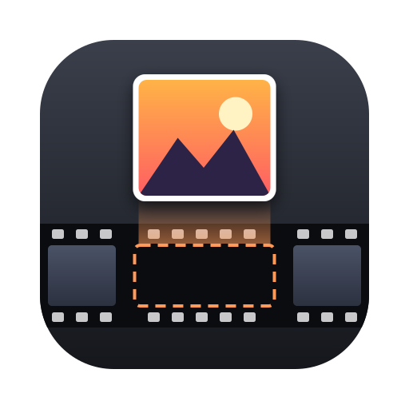
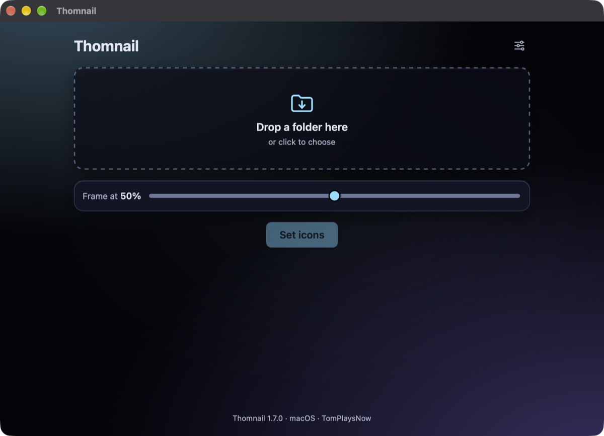
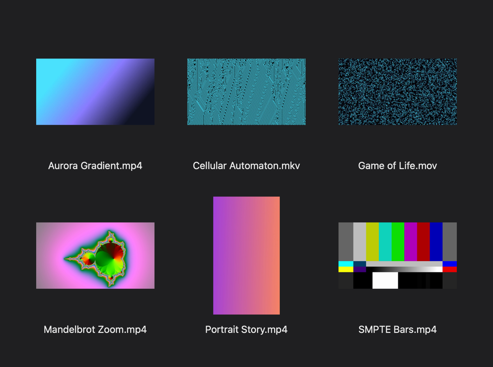

# Thomnail



**Set a chosen video frame as the Finder icon for whole folders of videos.**
Handy for video editors and anyone keeping video archives on a Mac.





Thomnail is a small macOS app by **TomPlaysNow**. Choose or drop a folder, pick the
position of the frame and click **Set icons**. Thomnail extracts that frame from every
video with FFmpeg and sets it as the file's Finder icon. The video data itself stays
unchanged.

Version **1.7.0** is built with **Tauri 2, Rust and React/TypeScript**. It uses the
system WebView and does not bundle Chromium or Node.js.

## Features

- Choose a folder in a dialog or by drag and drop
- Pick the frame position between 1 and 99 % of each video (default: 50 %)
- Optionally include subfolders and skip files that already have a custom icon
- Progress, clear per-file error messages with technical details, and a summary
- Cancel a running job; the current file is finished, the rest stays untouched
- Sharp 512 × 512 icons with transparent padding, so landscape and portrait videos
  keep their shape
- Interface in English, German, Chinese (Simplified), Hindi, Spanish and French;
  follows the system language by default, otherwise English
- Settings are saved; settings from earlier Electron/VideoThumb versions are migrated

Formats: `.mp4`, `.m4v`, `.mov`, `.mkv`, `.avi`, `.webm`, `.mts`, `.m2ts`, `.mpg`,
`.mpeg`, `.wmv`, `.3gp`.

## Installation

1. Download the ZIP from the [latest release](https://github.com/TomPlaysNow/thomnail/releases/latest),
   unzip it and move `Thomnail.app` to Applications.
2. Install **FFmpeg** (includes ffprobe), for example with Homebrew
   (`brew install ffmpeg`) or MacPorts (`sudo port install ffmpeg`).
3. The app is ad-hoc signed, not notarized, so macOS blocks the first launch. Open
   **System Settings → Privacy & Security** and click **Open Anyway**, or run
   `xattr -dr com.apple.quarantine /Applications/Thomnail.app`.

Requires macOS 11 or later. The release ZIP is built for Apple Silicon (arm64); on an
Intel Mac, build the app yourself (see below).

## Usage

1. Choose a video folder or drag it into the window.
2. Use **Frame at … %** to set where in each video the preview image is taken.
3. Optionally open Settings (gear icon) for language, subfolders and skipping files
   that already have an icon.
4. Click **Set icons** and follow the progress. **Cancel** stops after the current file.

Existing icons are only regenerated when **Skip files that were already processed**
is off, for example to upgrade older icons to 512 pixels.

To remove an icon: select the file in Finder → `⌘ I` → click the small icon at the
top left → `⌫`.

### FFmpeg

If no path is set in Settings, Thomnail looks for FFmpeg on every run in
`/opt/homebrew/bin`, `/usr/local/bin`, `/opt/local/bin` and then on the `PATH`, so an
FFmpeg installed after the first launch is found too. A path entered in Settings takes
precedence; clear the field to return to automatic detection. `ffprobe` must be next to
the `ffmpeg` in use.

Before the first file, Thomnail checks that ffmpeg, ffprobe and the Swift helper can be
started and reports a problem once, including the path it tried. Both tools are run
without a shell and with separate arguments; paths with spaces are supported.

### Settings file

Settings are stored in
`~/Library/Application Support/io.github.tomplaysnow.thomnail/settings.json`.
On first launch they are taken over from `Thomnail`, `thomnail` or `videothumb` in the
same Application Support folder; the old files are kept. Changes are saved atomically,
and a running job uses a fixed snapshot of the settings.

## How it works

```text
React/TypeScript → Tauri commands → Rust
                                   ├─ find videos
                                   ├─ check ffmpeg, ffprobe and helper once
                                   ├─ ffprobe: read the video length
                                   ├─ ffmpeg: extract the frame as a transparent PNG
                                   ├─ platform module: set the Finder icon
                                   └─ clean up temporary images
```

The video data stays unchanged. The custom Finder icon is stored in macOS metadata
(resource fork and FinderInfo); the `kHasCustomIcon` flag is used to detect files that
were already processed. File systems and network shares must support this metadata,
and it can be lost when files are copied.

## Platforms

**The released version supports macOS.** The Rust core and the interface are
cross-platform; the macOS integration lives separately in
`src-tauri/src/platform/macos.rs`, and a small Swift helper calls
`NSWorkspace.setIcon`.

Windows and Linux need their own integration with Explorer or the respective file
manager and are **not finished products yet**. On those platforms **Set icons** is
disabled and the Rust core returns a clear message. Video scanning and frame
extraction can be reused. See the [platform plan](docs/platforms.md) (German).

## Building

Requirements:

- Node.js 22.12 or later and npm
- Rust 1.90 or later with Cargo; a current stable toolchain is recommended
- Xcode Command Line Tools (`xcode-select --install`)

```bash
npm ci
npm start
```

This starts Tauri with the Vite dev server. On macOS the Swift helper is built
automatically for the target architecture.

For a finished macOS app:

```bash
npm run package
```

Result: `src-tauri/target/release/bundle/macos/Thomnail.app`, which can be moved to
`/Applications`.

For a ZIP to share:

```bash
npm run make
```

Result: `out/tauri/Thomnail-darwin-<arch>-1.7.0.zip`.

Local builds are ad-hoc signed. Developer ID signing and notarization for public
distribution have to be set up separately.

### Checks

```bash
npm run check
npm test
cargo test --manifest-path src-tauri/Cargo.toml -- --include-ignored
cargo clippy --manifest-path src-tauri/Cargo.toml --all-targets -- -D warnings
```

The integration tests (run with `--include-ignored`) need FFmpeg/ffprobe and, on macOS,
the automatically built Swift helper. They only work with temporary files and cover
real frame extraction, Finder icons, unchanged video data, skipping, error cases and
progress events.

## Project structure

```text
src/
  api.ts                  Tauri bridge and typed events
  types.ts                Shared frontend types
  i18n.ts                 All texts and error messages in six languages
  renderer.tsx            React entry point
  renderer/               User interface
src-tauri/
  src/main.rs             App, commands, processing and progress
  src/error.rs            Error codes that the frontend translates
  src/settings.rs         Storage, validation and migration
  src/video.rs            Cross-platform video scanning and FFmpeg calls
  src/platform/           File manager integration per operating system
  build.rs                Builds the Swift helper on macOS only
  tauri.conf.json         Shared app configuration
  tauri.macos.conf.json   macOS helper and signing
swift-helper/main.swift   Finder icon helper
build/                    License collection, icon generation and ZIP packaging
resources/                App icon and additional license texts
docs/                     Design reference, platform plan, audits, screenshots
```

## Translations

A new language needs an entry in `src/i18n.ts` (TypeScript reports missing texts) and
in `LANGUAGES` in `src-tauri/src/settings.rs`. The Chinese, Hindi, Spanish and French
texts are machine-made; corrections from native speakers are welcome.

## Design

The interface and app icon use the Aurora design: night blue, cyan for actions and
focus, and a subtle violet background gradient. Everything happens in one main view;
the frame slider lives only there. Long folder paths are available in full via
tooltip, error messages in the file list expand to show the full file path and can be
copied, and buttons, inputs and expandable details have visible keyboard focus.

The [Aurora design reference and Figma brief](docs/aurora-app-design.md) (German)
contains the full specification, including standards for future apps.

### Editing the app icon

The editable source is [`resources/icon.svg`](resources/icon.svg). After a change, this
script generates the transparent 1024 × 1024 PNG and the macOS ICNS file with sizes
from 16 to 1024 pixels:

```bash
bash build/icons.sh
```

It needs `rsvg-convert` from librsvg and the macOS tool `iconutil`. Regular builds use
the icon files in the repository, so regenerating is only needed after changing the
SVG. The icon license and the Aurora adaptation are documented in
[`resources/ICON-LICENSE.md`](resources/ICON-LICENSE.md).

## Changelog

### 1.7.0

- Cancel a running job; files after the current one are left untouched and marked
  as cancelled
- More formats: `.m4v`, `.webm`, `.mts`, `.m2ts`, `.mpg`, `.mpeg`, `.wmv`, `.3gp`
- Large folders update faster: the file list is sent once, progress refers to files
  by position
- Line icons instead of emoji, all colours as design tokens, one scroll area and a
  content width of at most 680 px
- The **Set icons** button keeps its place and is disabled until a folder is chosen;
  the summary appears above the file list
- Settings dialog: announced as a dialog, closes with Escape, keeps keyboard focus
  inside and returns it afterwards; clicking beside it no longer discards changes
- Folders can no longer be dropped while the settings dialog is open
- Progress bar and summary are announced to screen readers; the footer shows "macOS"

### 1.6.0

- Interface in six languages: English, German, Chinese (Simplified), Hindi, Spanish and
  French; chosen in Settings, defaulting to the system language
- Errors come from Rust as stable codes and are translated in the frontend; technical
  details are kept as-is
- Screenshots and an English README

### 1.5.0

- With no path set, FFmpeg is located on every run, even if it was installed after the
  first launch
- A missing ffmpeg, ffprobe or helper is reported once before the first file, with
  installation advice and the path that was tried
- Clear error messages per file, with the technical output under "Details"
- 512 × 512 icons with transparent padding instead of 320 pixels with black bars
- "No videos found" is shown as a neutral notice instead of a success
- Aurora interface and matching app icon in night blue and cyan
- Clearer frame label and a single slider in the main view
- Better readability and fully accessible paths and error details
- Reproducible PNG/ICNS generation from the SVG source with `build/icons.sh`
- Complete, self-contained Aurora design reference for other apps and Figma

### 1.4.0

- Replaced Electron with Tauri and Rust; React interface moved to TypeScript
- No bundled Chromium/Node.js runtime anymore
- File manager integration separated from the portable processing core
- Existing settings migrated; input validated and saved atomically
- Native Tauri folder picker and drag and drop
- Progress bar also counts skipped and failed files
- Full license texts of the new npm/Rust dependencies are included

### 1.3.0

- Author credit TomPlaysNow, full third-party license texts in the Electron build
- Code under MIT and app icon under CC BY 4.0 documented

### 1.2.0

- New name Thomnail (formerly VideoThumb) and settings migration

## License

Code: [MIT](LICENSE), © 2026 Tom (TomPlaysNow).
App icon: [CC BY 4.0](https://creativecommons.org/licenses/by/4.0/), see
[ICON-LICENSE.md](resources/ICON-LICENSE.md).

The build collects complete license and notice files for the npm production
dependencies and the resolved Rust dependencies, including build tools and the Rust
runtime. They are placed in `Thomnail.app/Contents/Resources/licenses/`. The Rust
notices link to the unmodified source packages. Some crates do not ship their license
texts in the crate archive; for the locked versions, texts from the respective source
repositories are kept in `resources/license-overrides/`, with provenance in
`sources.json`. The release build fails if a complete license text is missing.
FFmpeg and ffprobe are installed separately and not bundled.
